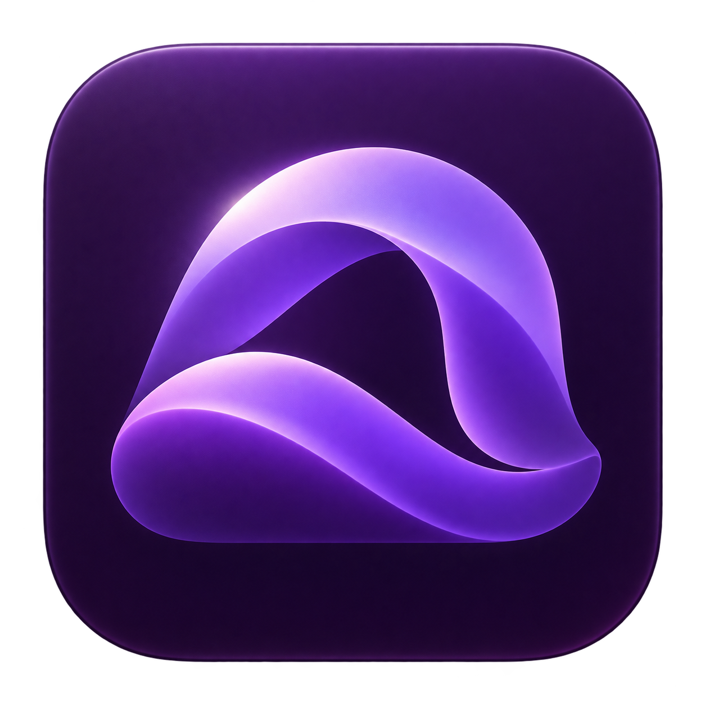

<p align="center"></p>
<h1 align="center">Ambient</h1>
<p align="center">Live wallpapers and movable desktop widgets for macOS.</p>

Ambient is a native SwiftUI/AppKit app for **macOS 14+ on Apple silicon**. It plays videos at their original quality by default, stays in the menu bar, and adds small desktop widgets you can arrange yourself.

**Early preview:** compatibility and performance are still evolving. Public builds are ad-hoc signed, **not Apple Developer ID signed or notarized**. MIT covers original Ambient code; the water-flow port has [unresolved third-party provenance](THIRD-PARTY-NOTICES.md#water-flow-shader-unresolved-third-party-provenance).

## What it does

- Muted, looping video wallpapers using AVPlayer and hardware decoding where supported.
- Images, native GIF playback, local HTML wallpapers, and a limited Metal renderer for Wallpaper Engine scene packages.
- Independent clock, date, CPU, estimated RAM, and network widgets. System readings update every 500 ms; the graph retains about one minute of upload/download history.
- **Edit on desktop** mode: drag each widget, then choose **Done** to restore click-through behavior. Each widget has its own size and saved position.
- Custom offline HTML/CSS widgets, live data bindings, and JSON import/export.
- Overview, wallpaper library, favorites, format filters, and recent playback events.
- Optional launch at login, multiple displays, sleep-aware playback, critical-memory recovery, and bounded video-stall recovery.

## Get started

Download an Apple-silicon DMG from [Releases](https://github.com/Claude-Reverser/Ambient/releases). Open it, launch **Animated Setup**, and choose an installation folder. The setup will not overwrite an existing Ambient installation.

Because preview downloads are not notarized, macOS may block them. If you choose to run a build you trust, use macOS's per-app **System Settings → Privacy & Security → Open Anyway** flow. Do not disable Gatekeeper globally. You can also build from source below.

In Ambient, choose **All wallpapers → Add wallpaper**, then double-click a card to apply it. Files remain in their original locations. Keep those folders available. Closing the library keeps playback running; quit from the menu bar to stop the app. The selected wallpaper resumes on launch unless you paused it.

For widgets, open **Widgets**, enable the ones you want, and choose **Edit on desktop**. The library minimizes while you arrange them. Position changes save when you release the mouse. Edit widgets stay below ordinary app windows.

## Quality and performance

| Mode | Video playback |
| --- | --- |
| Original, default | Source resolution and frame rate; no conversion |
| Balanced | Optional HEVC copy, up to 2560-pixel long edge / 30 fps |
| Eco | Optional HEVC copy, up to 1280-pixel long edge / 24 fps |

Optimized copies use a bounded 1 GiB completed-file cache. Original files are never modified. Initial conversion costs CPU/GPU time; playback reuses the result. More displays require more decoding and compositing. Web wallpapers and custom CSS can cost more than native widgets.

Widgets share one sampler. Clock/date redraw only when the minute changes; resizing reuses the affected window. Playback releases resources during sleep or an inactive session. Critical-memory pauses recover after pressure stays below critical for 20 seconds. Video recovery respects manual pauses. These controls are not a guarantee of a fixed CPU, GPU, or RAM budget.

[Performance notes](PERFORMANCE.md) describe historical measurements and their limits.

## Formats

| Input | Support |
| --- | --- |
| MP4, MOV, M4V | macOS-playable codecs; H.264/HEVC recommended |
| PNG, JPEG, HEIC, TIFF | Static proportional fit |
| GIF | Native ImageIO animation |
| HTML / extracted web-project folders | Local WebKit wallpaper; scripts may use the network |
| Wallpaper Engine `project.json` | Video/web entries and supported scene subset |
| Scene `.pkg` | One full-canvas image, optionally the recognized water-flow variant |
| Windows applications, arbitrary scene shaders, particles, audio reactivity | Unsupported |

There is no Workshop downloader. Import extracted files you are permitted to use. Wallpaper Engine host JavaScript APIs and general scene compatibility are not implemented. See [scene limits](SCENE-SUPPORT.md) and [third-party notices](THIRD-PARTY-NOTICES.md).

## Build

Install Xcode with a Swift 6 toolchain, select it with `xcode-select`, then:

```sh
git clone https://github.com/Claude-Reverser/Ambient.git
cd Ambient
swift test
./scripts/build-app.sh
open dist/Ambient.app
```

The app depends only on macOS system frameworks. The Swift package keeps Swift 5 language mode for compatibility. Release packaging currently targets arm64; Intel distribution is not tested.

To build the animated installer:

```sh
python3 -m venv .venv
.venv/bin/pip install -r scripts/requirements-dmg.txt
LAYOUT_PYTHON="$PWD/.venv/bin/python" ./scripts/build-dmg.sh
```

Output goes to `dist/`. See [distribution and signing](DISTRIBUTION.md) for the optional Developer ID/notarization flow. Secrets are never required to build or test a development copy.

## Contribute

Read [CONTRIBUTING.md](CONTRIBUTING.md) for the code layout, formatting and tests. [WIDGETS.md](WIDGETS.md) documents the versioned widget package format. A hosted community widget library is planned; this release supports local JSON exchange and one custom design at a time.

Original contributions use [MIT](LICENSE), subject to [third-party notices](THIRD-PARTY-NOTICES.md). Ambient is not affiliated with Wallpaper Engine, Steam, or Apple.
